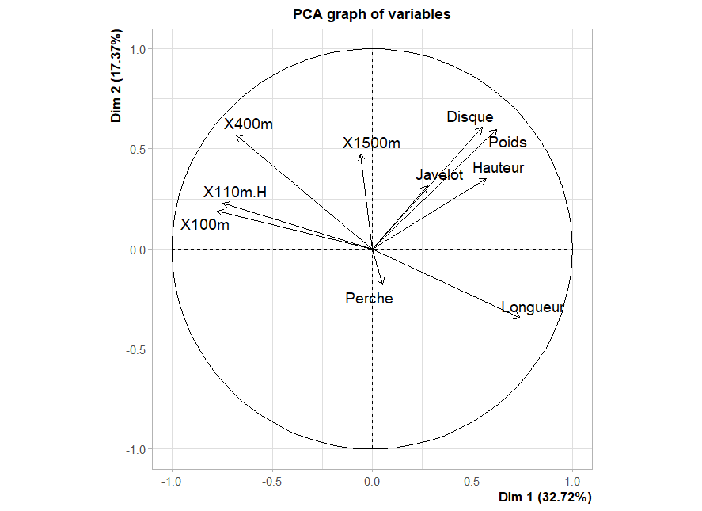
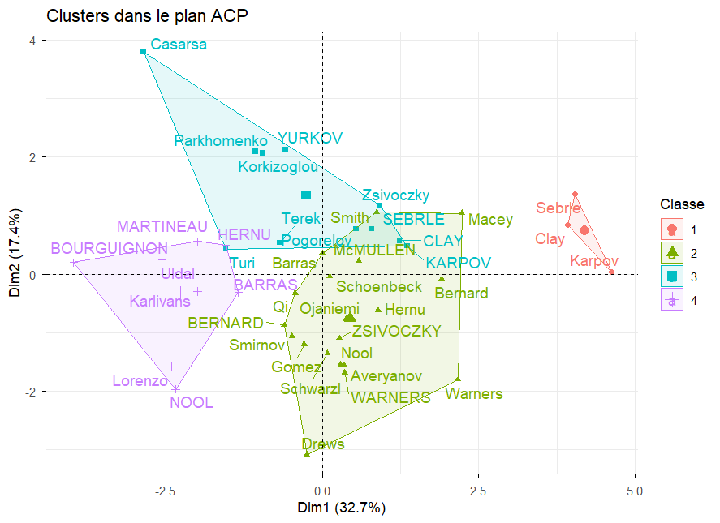
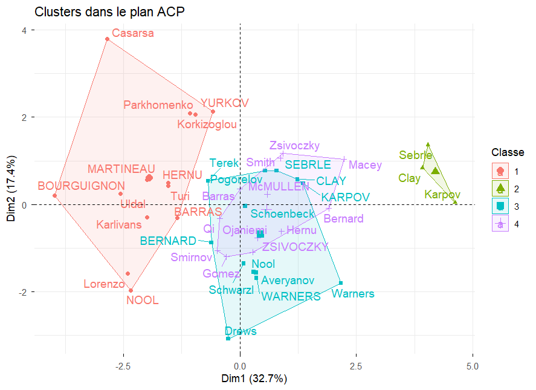
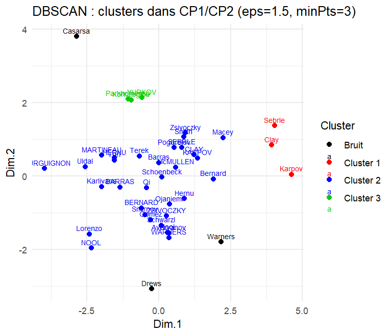

# Méthodes de classification non supervisée (Cluster analysis)

*Travail personnel réalisé par **Manuella IKOUTOU SOUAMY** et **Dyhia BENHADDAD**, encadré par Mme **Sylviane WEY** ·* 
*Master 1 Mathématiques et Applications - Université Le Havre Normandie*

**[Lire le rapport complet (PDF)](Methodes_de_classification_non_supervisee.pdf)**

## Problématique
En apprentissage non supervisé, les données ne sont pas étiquetées : le nombre et la nature des groupes sont inconnus *a priori*. 
Notre étude cherche donc à répondre à la problématique suivante :
> Comment les différentes méthodes de classification non supervisée permettent-elles de révéler des structures significatives au sein d'un jeu de données et selon quels critères peut-on objectivement évaluer et comparer la qualité des partitions obtenues ?

## Données

### Decathlon (application principale)

- **41 observations** : des athlètes ayant participé à deux compétitions, les *Jeux Olympiques (28)* et le *Decastar (13)*.
- **13 variables** : les *10 épreuves* (100 m, longueur, poids, hauteur, 400 m, 110 m haies, disque, perche, javelot, 1500 m), le *nombre de points*, le *classement* et la *compétition*.
  
  Pour les épreuves chronométrées (100 m, 400 m, 110 m haies, 1500 m), une valeur élevée correspond à une moins bonne performance. Pour les sauts et les lancers, une valeur élevée correspond à une meilleure performance.

**Pré-traitement :**
1. Sélection des variables quantitatives.
2. Suppression des variables *Points* et *Classement*, qui sont calculées à partir des dix épreuves (les garder biaiserait la classification).
3. Centrage-réduction des dix épreuves exprimées dans des unités différentes (secondes et mètres).

## Démarche

### Méthodes
 
- **ACP** : réalisée en amont pour vérifier qu'il existe une structure dans les données et obtenir un plan commun (CP1, CP2), dans lequel les classifications sont projetées et comparées.
- **CAH** : appliquée aux 10 épreuves standardisées, avec le critère de Ward et la distance euclidienne, puis découpage du dendrogramme.
- **K-means** : appliqué aux 10 épreuves standardisées, avec 25 initialisations et une graine fixée.
- **DBSCAN** : testé d'abord sur les 10 épreuves standardisées, où il ne détecte qu'une seule classe, puis appliqué aux coordonnées des athlètes dans le plan (CP1, CP2).

### Critères d'évaluation
 
- **Nombre de classes** : saut d'inertie (CAH), méthode du coude (K-means), indice de silhouette, graphique des distances aux k plus proches voisins pour fixer ε (DBSCAN).
- **Qualité des partitions** : silhouette moyenne, ainsi que le coefficient agglomératif pour la CAH.
- **Interprétation des classes** : épreuves dont la moyenne dans une classe diffère significativement de la moyenne globale.
- **Lien avec l'ACP** : rapport de corrélation η² entre les classes et les axes CP1 et CP2.
  
## Résultats

### 1. Analyse en Composantes Principales

| Composante | Valeur propre | % de variance | % cumulé |
|---|---|---|---|
| CP1 | 3.27 | 32.72 % | 32.72 % |
| CP2 | 1.74 | 17.37 % | 50.09 % |
| CP3 | 1.40 | 14.05 % | 64.14 % |
| CP4 | 1.06 | 10.57 % | 74.71 % |

- La **règle de Kaiser** retient 4 composantes (74.71 % de la variance). Le plan (CP1, CP2), qui représente 50.09 % de la variance, sert de plan de représentation commun.
- **CP1 (axe de performance globale)** oppose les épreuves de course (100 m : −0.77, 110 m haies : −0.75, 400 m : −0.68) à la longueur (0.74), au poids (0.62), à la hauteur (0.57) et au disque (0.55).
- **CP2 (axe de lancer et d'endurance)** est corrélé au disque (0.61), au poids (0.60), au 400 m (0.57) et au 1500 m (0.47) et s'oppose à la longueur (−0.35).
- La **perche** est mal représentée dans ce plan (0.05 sur CP1, −0.18 sur CP2).
- Les ellipses des deux compétitions se chevauchent : le plan ne sépare pas les athlètes des JO de ceux du Decastar.

  

### 2. Choix du nombre de classes

| Méthode | Critères | Indications | Choix retenu |
|---|---|---|---|
| **CAH** | Saut d'inertie, silhouette (K de 2 à 10) | Saut marqué vers 5 classes, second saut vers 4 classes. Silhouette : maximum local à K = 6 | K = 4, pour l'interprétabilité et des effectifs suffisants |
| **K-means** | Méthode du coude, silhouette | Coude : le gain marginal diminue à partir de K = 4. Silhouette : maximum à K = 2 | K = 4, pour l'interprétabilité et la comparaison avec la CAH |
| **DBSCAN** | k-NN distance plot | Sur les 10 variables (MinPts = 4) : pas de coude net, une seule classe pour ε = 2.5, 3, 3.5 et 4. Sur (CP1, CP2) avec MinPts = 3 : coude vers ε ≈ 1.5 | ε = 1.5 et MinPts = 3 sur (CP1, CP2) |

### 3. Partitions obtenues dans le plan (CP1, CP2)

<table>
  <tr>
    <th align="center">CAH (Ward, 4 classes)</th>
    <th align="center">K-means (4 classes)</th>
    <th align="center">DBSCAN (3 classes et bruit)</th>
  </tr>
  <tr>
    <td></td>
    <td></td>
    <td></td>
  </tr>
</table>

### 4. Comparaison des trois méthodes

| | CAH (Ward) | K-means | DBSCAN |
|---|---|---|---|
| Espace de classification | 10 variables standardisées | 10 variables standardisées | Plan (CP1, CP2) |
| Nombre de classes | 4 | 4 | 3 et 3 points de bruit |
| Effectifs | 3 / 19 / 11 / 8 | 13 / 3 / 13 / 12 | 3 / 32 / 3 et 3 points de bruit |
| Autre indicateur | Coefficient agglomératif : 0,76 | Variance expliquée : 39.507 % | – |
| **Silhouette moyenne** | 0.131 | 0.141 | **0.291** (38 individus hors bruit) |
| **η² avec CP1** | 0.734 | **0.805** | 0.431 |
| **η² avec CP2** | **0.470** | 0.176 | 0.239 |

- Les trois méthodes isolent la même classe d'élite : Sebrle, Clay et Karpov (aux JO), situés à l'extrémité droite de CP1.
- Les classes des **K-means** sont les plus alignées sur CP1 (η² = 0.805). La **CAH** capte aussi une part importante de CP2 (η² = 0.470).
- **DBSCAN** est inadapté en dimension 10 avec 41 individus car les distances s'homogénéisent. Appliqué au plan factoriel, il fait apparaître un petit groupe situé en haut de CP2 et 3 athlètes non classés (Warners, Drews, Casarsa). Ce ne sont pas des valeurs aberrantes mais des profils isolés : Warners, par exemple, a un cos² de 0,90 dans le plan.

<b>Détail des classes : CAH</b>

| Classe | n | Score moyen | Profil (variables significatives avec <code>catdes</code>) | Silhouette |
|---|---|---|---|---|
| 1 | 3 | 8 813 pts | Sebrle, Clay et Karpov, les médaillés des JO. Meilleurs en longueur, disque, poids, javelot et hauteur, plus rapides au 100 m, 400 m et 110 m haies. Athlètes complets | 0.327 |
| 2 | 19 | 8 082 pts | Athlètes des deux compétitions. Temps significativement inférieurs à la moyenne sur toutes les courses (1500 m, 400 m, 110 m haies, 100 m) : vitesse et endurance | 0.147 |
| 3 | 11 | 7 940 pts | Plus lents au 1500 m et au 400 m, plus faibles en longueur | −0.005 |
| 4 | 8 | 7 610 pts | Majoritairement des athlètes du Decastar. Plus lents au 100 m et au 110 m haies, plus faibles en hauteur et au poids. Niveau global le plus faible | 0.207 |

<b>Détail des classes : K-means</b>

| Classe | n | Score moyen | Profil (variables significatives avec <code>catdes</code>) | Silhouette |
|---|---|---|---|---|
| 1 | 13 | 7 655 pts | Comparable à la classe 4 de la CAH, avec 5 athlètes de la classe 3 de la CAH en plus. Plus lents au 100 m, 400 m et 110 m haies, plus faibles en longueur | 0.060 |
| 2 | 3 | – | Identique à la classe 1 de la CAH (Sebrle, Clay, Karpov) | 0.303 |
| 3 | 13 | 8 094 pts | 8 athlètes de la classe 2 et 5 de la classe 3 de la CAH. Une seule variable significative : la perche (5.05 m contre 4.76 m en moyenne). Profil de spécialistes de la perche | 0.133 |
| 4 | 12 | 8 088 pts | 1500 m plus rapide (270.82 s contre 279.02 s) et perche plus faible (4.51 m contre 4.76 m). Profil endurant | 0.195 |

<b>Détail des classes : DBSCAN</b>

| Classe | n | Profil (variables significatives avec <code>catdes</code>) | Silhouette |
|---|---|---|---|
| 1 | 3 | Sebrle, Clay et Karpov, identique à la classe 1 de la CAH et à la classe 2 des K-means | 0.785 |
| 2 | 32 | La majorité des athlètes, répartis de façon continue dans le plan. Disque et poids significativement inférieurs à la moyenne | 0.189 |
| 3 | 3 | Parkhomenko, Korkizoglou et YURKOV, avec des coordonnées élevées sur CP2. Seule variable significative : le 400 m (p = 0.050) | 0.885 |
| Bruit | 3 | Warners, Drews et Casarsa, dont les positions sont isolées dans le plan | – |

## Conclusion

- Chaque méthode repose sur des hypothèses différentes. La **CAH** fournit une lecture hiérarchique grâce au dendrogramme. Les **K-means** sont simples et rapides, mais le nombre de classes doit être fixé à l'avance. **DBSCAN** détecte le bruit et des classes de forme arbitraire, mais dépend fortement de ε et de MinPts.
- Sur Decathlon, les silhouettes restent faibles : la structure est significative mais modérée. Les trois méthodes s'accordent sur les athlètes d'élite et divergent sur les autres profils.
- **Aucune méthode ne s'impose universellement.** Le choix dépend de la nature des données, de leur organisation dans l'espace, de la présence de bruit et des objectifs de l'analyse. Les méthodes sont complémentaires.

## Logiciel et packages
Toute l'analyse est réalisé avec le logiciel **R** et les packages suivants :`FactoMineR`, `factoextra`, `cluster`, `dbscan`.

