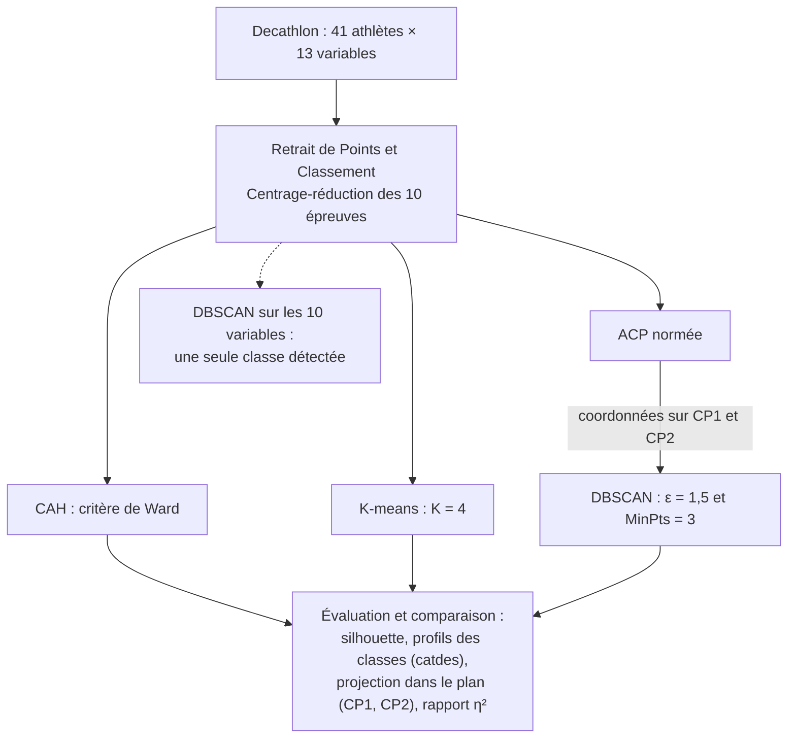

# Méthodes de classification non supervisée (Cluster analysis)

Étude théorique et comparative de trois méthodes de clustering, la **Classification Ascendante Hiérarchique (CAH)**, les **K-means** et **DBSCAN**, précédées d'une **Analyse en Composantes Principales (ACP)**. Les méthodes sont appliquées au jeu de données **Decathlon** (41 athlètes, 10 épreuves). Toutes les analyses sont réalisées avec **R**.

📄 **[Lire le rapport complet (PDF, 55 pages)](Methodes_de_classification_non_supervisee.pdf)**

---

## Sommaire

- [Problématique](#problématique)
- [Contenu du rapport](#contenu-du-rapport)
- [Données](#données)
- [Démarche](#démarche)
- [Résultats](#résultats)
- [Conclusion](#conclusion)
- [Structure du dépôt](#structure-du-dépôt)
- [Reproduire l'analyse](#reproduire-lanalyse)
- [Auteures](#auteures)
- [Références](#références)

---

## Problématique

> Comment les différentes méthodes de classification non supervisée permettent-elles de révéler des structures significatives au sein d'un jeu de données, et selon quels critères peut-on objectivement évaluer et comparer la qualité des partitions obtenues ?

En l'absence de groupes de référence connus, deux difficultés se posent : **choisir la méthode** adaptée aux données, puis **évaluer la qualité d'une partition** et le nombre de classes.

## Contenu du rapport

| Partie | Contenu |
|---|---|
| **1. Fondamentaux théoriques** | Mesures de similarité et de dissimilarité (distances de Manhattan, de Tchebychev, euclidienne, de Hamming), centrage-réduction, partition, hiérarchie indicée, inertie totale, intra-classe et inter-classe, théorème de Huygens (démontré en annexe), ACP normée |
| **2. Étude des méthodes** | **CAH** : algorithme et cinq critères d'agrégation (lien simple, complet, moyen, centre de gravité, Ward), illustrés sur `USArrests`. **K-means** : principe et algorithme. **DBSCAN** : ε-voisinage, points centraux, frontières et bruit, accessibilité et connectivité par densité, choix de ε et MinPts. Avantages et limites de chaque méthode |
| **3. Critères de validation** | Méthode du coude, indice de silhouette, indice de Davies-Bouldin |
| **4. Application** | ACP puis CAH, K-means et DBSCAN sur Decathlon, et lien entre l'ACP et chaque classification (rapport de corrélation η²) |

> L'indice de Davies-Bouldin est présenté en partie théorique. Dans l'application, les partitions sont évaluées par la silhouette, la méthode du coude (K-means), le saut d'inertie et le coefficient agglomératif (CAH), ainsi que le k-NN distance plot (DBSCAN).

## Données

### Decathlon (application principale)

- **41 observations** : des athlètes ayant participé à deux compétitions, les **Jeux Olympiques (28)** et le **Decastar (13)**.
- **13 variables** : les **10 épreuves** (100 m, longueur, poids, hauteur, 400 m, 110 m haies, disque, perche, javelot, 1500 m), le **nombre de points**, le **classement** et la **compétition**.
- **Sens des variables** : pour les épreuves chronométrées (100 m, 400 m, 110 m haies, 1500 m), une valeur élevée correspond à une moins bonne performance. Pour les sauts et les lancers, une valeur élevée correspond à une meilleure performance.

**Pré-traitement :**
1. Sélection des variables quantitatives.
2. Suppression de `Points` et `Classement`, qui sont calculées à partir des dix épreuves et biaiseraient la classification.
3. Centrage-réduction des dix épreuves avec `scale()`, car elles sont exprimées dans des unités différentes (secondes et mètres).

### USArrests (illustration des critères d'agrégation)

Jeu de données intégré à R : **50 États** des États-Unis décrits par 4 variables (`Murder`, `Assault`, `UrbanPop`, `Rape`), standardisées. Il sert à comparer les critères d'agrégation de la CAH, avec un découpage en 3 classes.

## Démarche



| Étape | Fonction R | Paramètres utilisés |
|---|---|---|
| ACP | `FactoMineR::PCA` | `scale.unit = TRUE` |
| CAH | `cluster::agnes` | `method = "ward"` sur les 10 variables standardisées, découpage avec `cutree(k = 4)` |
| K-means | `kmeans` | `centers = 4`, `nstart = 25`, `iter.max = 100`, `set.seed(123)` |
| DBSCAN | `dbscan::dbscan` | `eps = 1.5`, `minPts = 3` sur les coordonnées (CP1, CP2) |
| Silhouette | `cluster::silhouette` | distance euclidienne sur les 10 variables standardisées (CAH, K-means), sur (CP1, CP2) hors bruit (DBSCAN) |
| Description des classes | `FactoMineR::catdes` | v.test et p-valeur par variable |
| Lien avec l'ACP | `aov` | η² = somme des carrés inter-classes / somme des carrés totale, pour CP1 et CP2 |

## Résultats

### 1. Analyse en Composantes Principales

| Composante | Valeur propre | % de variance | % cumulé |
|---|---|---|---|
| CP1 | 3,27 | 32,72 % | 32,72 % |
| CP2 | 1,74 | 17,37 % | 50,09 % |
| CP3 | 1,40 | 14,05 % | 64,14 % |
| CP4 | 1,06 | 10,57 % | 74,71 % |

- La **règle de Kaiser** retient 4 composantes (74,71 % de la variance). Le plan **(CP1, CP2)**, qui représente **50,09 %** de la variance, sert de plan de représentation commun.
- **CP1 : axe de performance globale.** Il oppose les épreuves de course (100 m : −0,77, 110 m haies : −0,75, 400 m : −0,68) à la longueur (0,74), au poids (0,62), à la hauteur (0,57) et au disque (0,55).
- **CP2 : axe de lancer et d'endurance.** Il est corrélé au disque (0,61), au poids (0,60), au 400 m (0,57) et au 1500 m (0,47), et s'oppose à la longueur (−0,35).
- La **perche** est mal représentée dans ce plan (0,05 sur CP1, −0,18 sur CP2).
- Les ellipses des deux compétitions se **chevauchent** : le plan ne sépare pas les athlètes des JO de ceux du Decastar.

<p align="center">
  
</p>

### 2. Choix du nombre de classes

| Méthode | Critères | Indications | Choix retenu |
|---|---|---|---|
| **CAH** | Saut d'inertie, silhouette (K de 2 à 10) | Saut marqué vers 5 classes, second saut vers 4 classes. Silhouette : maximum local à K = 6 | **K = 4**, pour l'interprétabilité et des effectifs suffisants |
| **K-means** | Méthode du coude, silhouette | Coude : le gain marginal diminue à partir de K = 4. Silhouette : maximum à K = 2 | **K = 4**, pour l'interprétabilité et la comparaison avec la CAH |
| **DBSCAN** | k-NN distance plot | Sur les 10 variables (MinPts = 4) : pas de coude net, **une seule classe** pour ε = 2,5, 3, 3,5 et 4. Sur (CP1, CP2) avec MinPts = 3 : coude vers ε ≈ 1,5 | **ε = 1,5 et MinPts = 3** sur (CP1, CP2) |

### 3. Partitions obtenues dans le plan (CP1, CP2)

<table>
  <tr>
    <th align="center">CAH (Ward, 4 classes)</th>
    <th align="center">K-means (4 classes)</th>
    <th align="center">DBSCAN (3 classes et bruit)</th>
  </tr>
  <tr>
    <td></td>
    <td></td>
    <td></td>
  </tr>
</table>

### 4. Comparaison des trois méthodes

| | CAH (Ward) | K-means | DBSCAN |
|---|---|---|---|
| Espace de classification | 10 variables standardisées | 10 variables standardisées | Plan (CP1, CP2) |
| Nombre de classes | 4 | 4 | 3 et 3 points de bruit |
| Effectifs | 3 / 19 / 11 / 8 | 13 / 3 / 13 / 12 | 3 / 32 / 3 et 3 points de bruit |
| **Silhouette moyenne** | **0,131** | **0,141** | **0,291** (38 individus hors bruit) |
| Autre indicateur | Coefficient agglomératif : 0,76 | Variance expliquée (B/T) : 39,507 % | – |
| **η² avec CP1** | 0,734 | **0,805** | 0,431 |
| **η² avec CP2** | **0,470** | 0,176 | 0,239 |

**À retenir :**
- Les trois méthodes isolent **la même classe d'élite** : Sebrle, Clay et Karpov (aux JO), situés à l'extrémité droite de CP1.
- Les classes des **K-means** sont les plus alignées sur CP1 (η² = 0,805). La **CAH** capte aussi une part importante de CP2 (η² = 0,470).
- **DBSCAN** est inadapté en dimension 10 avec 41 individus, car les distances s'homogénéisent. Appliqué au plan factoriel, il fait apparaître un petit groupe situé en haut de CP2 et **3 athlètes non classés** (Warners, Drews, Casarsa). Ce ne sont pas des valeurs aberrantes mais des profils isolés : Warners, par exemple, a un cos² de 0,90 dans le plan.
- La silhouette de DBSCAN est calculée dans le plan (CP1, CP2) sans les points de bruit. Celles de la CAH et des K-means sont calculées sur les 10 variables standardisées.

<details>
<summary><b>Détail des classes : CAH</b></summary>

| Classe | n | Score moyen | Profil (variables significatives avec <code>catdes</code>) | Silhouette |
|---|---|---|---|---|
| 1 | 3 | 8 813 pts | Sebrle, Clay et Karpov, les médaillés des JO. Meilleurs en longueur, disque, poids, javelot et hauteur, plus rapides au 100 m, 400 m et 110 m haies. Athlètes complets | 0,327 |
| 2 | 19 | 8 082 pts | Athlètes des deux compétitions. Temps significativement inférieurs à la moyenne sur toutes les courses (1500 m, 400 m, 110 m haies, 100 m) : vitesse et endurance | 0,147 |
| 3 | 11 | 7 940 pts | Plus lents au 1500 m et au 400 m, plus faibles en longueur | −0,005 |
| 4 | 8 | 7 610 pts | Majoritairement des athlètes du Decastar. Plus lents au 100 m et au 110 m haies, plus faibles en hauteur et au poids. Niveau global le plus faible | 0,207 |

</details>

<details>
<summary><b>Détail des classes : K-means</b></summary>

| Classe | n | Score moyen | Profil (variables significatives avec <code>catdes</code>) | Silhouette |
|---|---|---|---|---|
| 1 | 13 | 7 655 pts | Comparable à la classe 4 de la CAH, avec 5 athlètes de la classe 3 de la CAH en plus. Plus lents au 100 m, 400 m et 110 m haies, plus faibles en longueur | 0,060 |
| 2 | 3 | – | Identique à la classe 1 de la CAH (Sebrle, Clay, Karpov) | 0,303 |
| 3 | 13 | 8 094 pts | 8 athlètes de la classe 2 et 5 de la classe 3 de la CAH. Une seule variable significative : la perche (5,05 m contre 4,76 m en moyenne). Profil de spécialistes de la perche | 0,133 |
| 4 | 12 | 8 088 pts | 1500 m plus rapide (270,82 s contre 279,02 s) et perche plus faible (4,51 m contre 4,76 m). Profil endurant | 0,195 |

</details>

<details>
<summary><b>Détail des classes : DBSCAN</b></summary>

| Classe | n | Profil (variables significatives avec <code>catdes</code>) | Silhouette |
|---|---|---|---|
| 1 | 3 | Sebrle, Clay et Karpov, identique à la classe 1 de la CAH et à la classe 2 des K-means | 0,785 |
| 2 | 32 | La majorité des athlètes, répartis de façon continue dans le plan. Disque et poids significativement inférieurs à la moyenne | 0,189 |
| 3 | 3 | Parkhomenko, Korkizoglou et YURKOV, avec des coordonnées élevées sur CP2. Seule variable significative : le 400 m (p = 0,050) | 0,885 |
| Bruit | 3 | Warners, Drews et Casarsa, dont les positions sont isolées dans le plan | – |

</details>

<details>
<summary><b>Partie théorique : critères d'agrégation de la CAH sur USArrests (k = 3)</b></summary>

| Critère | Effectifs des 3 classes | Hauteur maximale de fusion | Observation |
|---|---|---|---|
| Lien simple | 48 / 1 / 1 (Alaska et Florida isolés) | ≈ 2 | Effet de chaîne, aucune structure réelle |
| Lien complet | 8 / 11 / 31 | ≈ 6 | Partition plus équilibrée et interprétable |
| Lien moyen | 19 / 1 / 30 (Alaska isolé) | ≈ 3 | Intermédiaire entre les liens simple et complet |
| Centre de gravité | 48 / 1 / 1 (Alaska et Vermont isolés) | – | 7 inversions dans le dendrogramme |
| **Ward** | **19 / 12 / 19** | ≈ 12 | Partition la plus équilibrée, **critère retenu pour l'application** |

</details>

## Conclusion

- Chaque méthode repose sur des hypothèses différentes. La **CAH** fournit une lecture hiérarchique grâce au dendrogramme. Les **K-means** sont simples et rapides, mais le nombre de classes doit être fixé à l'avance. **DBSCAN** détecte le bruit et des classes de forme arbitraire, mais dépend fortement de ε et de MinPts.
- Sur Decathlon, les silhouettes restent faibles : la structure est **significative mais modérée**. Les trois méthodes s'accordent sur les athlètes d'élite et divergent sur les autres profils.
- **Aucune méthode ne s'impose universellement.** Le choix dépend de la nature des données, de leur organisation dans l'espace, de la présence de bruit et des objectifs de l'analyse. Les méthodes sont complémentaires.

## Structure du dépôt

```
classification-non-supervisee/
├── README.md
├── rapport/
│   ├── Methodes_de_classification_non_supervisee.pdf   # Rapport final (55 pages)
│   └── latex/                                          # Sources LaTeX du rapport et figures
├── scripts/
│   ├── 01_ACP.R                                        # Section 4.2
│   ├── 02_CAH.R                                        # Sections 4.3 et 4.6.1
│   ├── 03_K-means.R                                    # Sections 4.4 et 4.6.2
│   ├── 04_DBSCAN.R                                     # Sections 4.5 et 4.6.3
│   └── USArrests.R                 # Section 2.1.3
├── data/
│   └── README.md                                       # Emplacement du fichier decath.Rda
└── figures/                                            # Figures reprises dans ce README
```

| Script | Contenu |
|---|---|
| `01_ACP.R` | Matrice des corrélations, ACP normée, critère de Kaiser, scree plots, contributions des variables et des individus, cos² des individus, répartition par compétition |
| `02_CAH.R` | CAH de Ward, dendrogramme, saut d'inertie, silhouettes pour K de 2 à 10, découpage en 4 classes, profils (`aggregate`, `catdes`), silhouette, η² ; comparaison avec les liens simple, complet, moyen et centre de gravité |
| `03_K-means.R` | Méthode du coude et silhouettes (K de 1 à 10 et de 2 à 10), K-means avec K = 4, inerties intra et inter-classes, profils, silhouette, η² |
| `04_DBSCAN.R` | k-NN distance plots, tests de ε sur les 10 variables puis sur (CP1, CP2), modèle final, profils, silhouette hors bruit, η² |
| `USArrests.R` | CAH avec les 5 critères d'agrégation, découpage en 3 classes, détection des inversions du centre de gravité, tableau comparatif |

## Reproduire l'analyse

**Prérequis :** R avec les packages `FactoMineR`, `factoextra`, `cluster` et `dbscan`. Les scripts Decathlon les installent automatiquement s'ils sont absents (`if(!require(...)) install.packages(...)`).

1. Cloner le dépôt :
   ```bash
   git clone https://github.com/<votre-pseudo>/classification-non-supervisee.git
   ```
2. Placer le fichier de données `decath.Rda` dans le dossier `data/` (voir [`data.README.md`](data.README.md)).
3. Définir la racine du dépôt comme répertoire de travail :
   ```r
   setwd("chemin/vers/classification-non-supervisee")
   ```
4. Exécuter les scripts de `01_ à 04_`. Ils sont indépendants : chacun recharge et prépare les données. `USArrests.R` utilise un jeu de données intégré à R et ne nécessite aucun fichier.


## Auteures
Travail personnel encadré réalisé en binôme avec **Dyhia BENHADDAD** sous l'encadrement de **Mme Sylviane WEY** . Master 1 Mathématiques et Applications · UFR Sciences et Techniques, Université Le Havre Normandie · Année universitaire 2025-2026 ·

## Références

<details>
<summary>Bibliographie du rapport (17 références)</summary>

1. Brian S. Everitt, Sabine Landau, Morven Leese, Daniel Stahl, *Cluster Analysis*, 5th Edition, Wiley, 2011.
2. Jean-Pierre Nakache et Josiane Confais, *Méthodes de classification*, Éditions Technip, 2004.
3. Sylviane Wey, *Classification Ascendante Hiérarchique (Chapitre 5)*, polycopié de cours de Master 1, Université Le Havre Normandie, 2025.
4. Jean-Marie Monnez, *Méthodes de classification non supervisée*, cours d'analyse des données et apprentissage, Université de Lorraine, 2021.
5. Marie Chavent, [*Classification de données quantitatives*](https://marie-chavent.perso.math.cnrs.fr/wp-content/uploads/2013/10/cours_classif_quanti.pdf), cours, Université de Bordeaux, 2013.
6. Valérie Monbet, [*Clustering et Classification Ascendante Hiérarchique (CAH) - Introduction*](https://perso.univ-rennes1.fr/valerie.monbet/ISD/clustering_intro_CAH.pdf), cours, Université de Rennes 1.
7. Christine Keribin, [*Apprentissage statistique supervisé et non supervisé*](https://www.imo.universite-paris-saclay.fr/~christine.keribin/STA203/ENSTA-STA203-Poly-2024.pdf), cours, Université Paris-Saclay, 2014.
8. Wikistat, [*Classification non supervisée*](http://wikistat.fr/pdf/st-m-explo-classif.pdf), Université de Toulouse.
9. CNAM, [*Méthodes de classification*](https://maths.cnam.fr/IMG/pdf/METHODES_DE_CLASSIFICATION-2014_cle4ad38b.pdf), support de cours, 2014.
10. DataCamp, [*Normalization vs Standardization: Key Differences Explained*](https://www.datacamp.com/fr/tutorial/normalization-vs-standardization), tutoriel en ligne.
11. Marie Chavent, [*Analyse en composantes principales*](https://marie-chavent.perso.math.cnrs.fr/wp-content/uploads/2013/10/ACP_L3.pdf), cours, Université de Bordeaux.
12. Wilson Toussile, [*Analyse en Composantes Principales (ACP) : Un Guide Complet*](https://toussile.quarto.pub/data-science/posts/machine-learning/reduction-dimentionalite/02-acp.html).
13. Ricco Rakotomalala, [*Analyse en Composantes Principales (ACP)*](https://eric.univ-lyon2.fr/ricco/cours/slides/ACP.pdf), cours, Université Lumière Lyon 2.
14. CNAM, [*Reconnaissance des formes et méthodes neuronales (RCP208) : Classification automatique par densité (DBSCAN)*](https://cedric.cnam.fr/vertigo/Cours/ml/docs/3coursDBSCAN.pdf).
15. DataCamp, [*A Guide to the DBSCAN Clustering Algorithm*](https://www.datacamp.com/fr/tutorial/dbscan-clustering-algorithm), tutoriel en ligne.
16. Ricco Rakotomalala, [*Mesures de qualité des partitions en classification automatique*](https://eric.univ-lyon2.fr/ricco/cours/slides/classif_mesures.pdf), Université Lyon 2.
17. TÉLUQ, [*INF1421 - Module 6 : Regroupement (Clustering)*](https://inf1421.teluq.ca/files/2016/09/INF1421-Module6-Regroupement-Jan2019.pdf), 2019.

</details>
